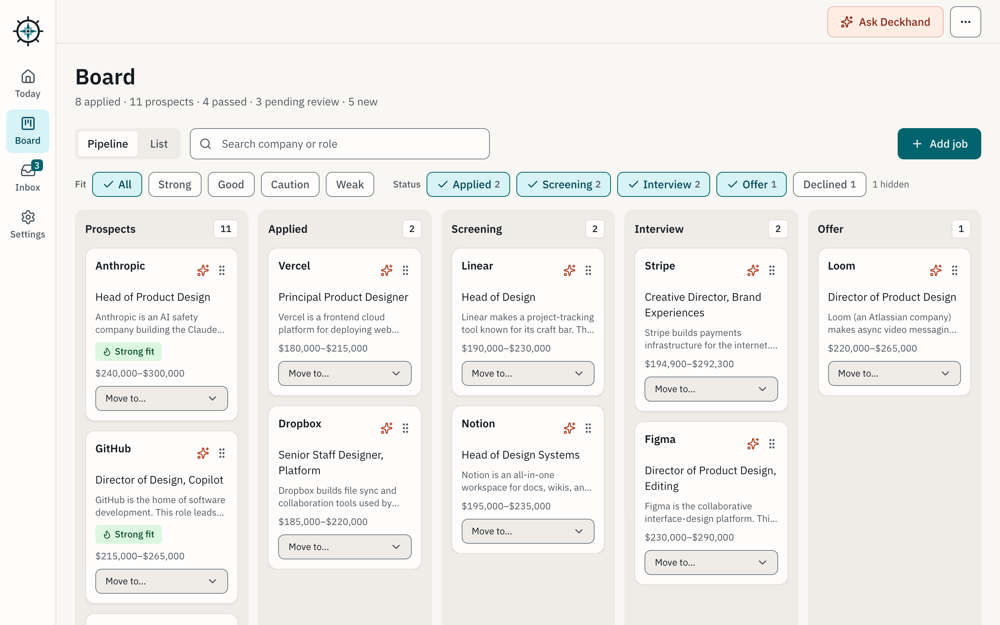
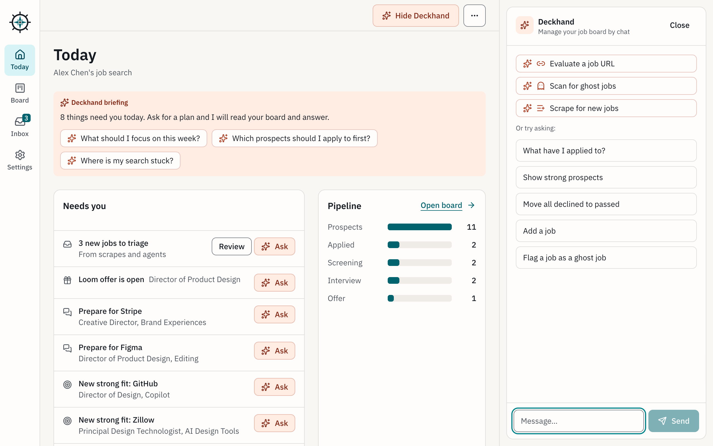
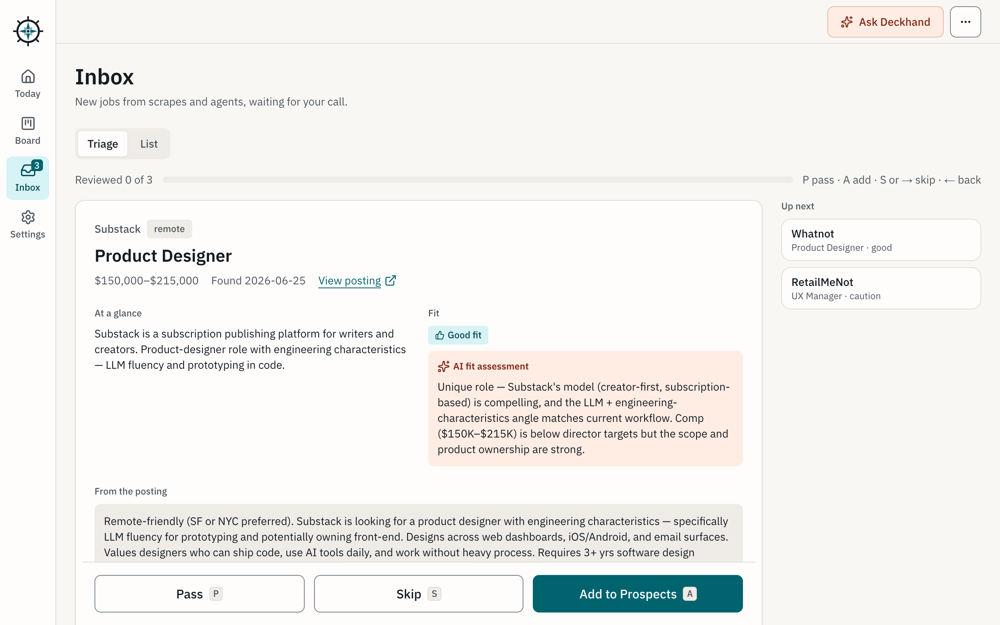
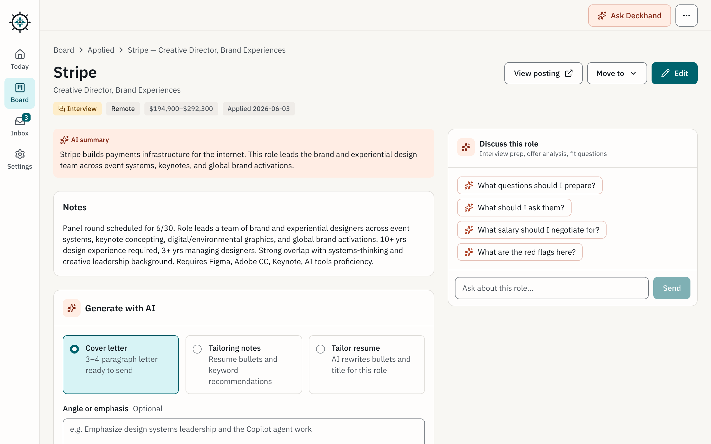
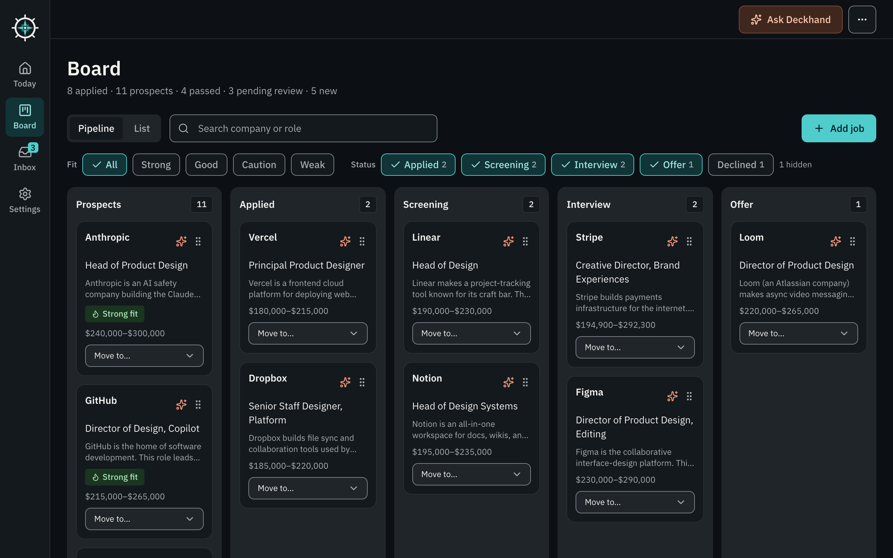
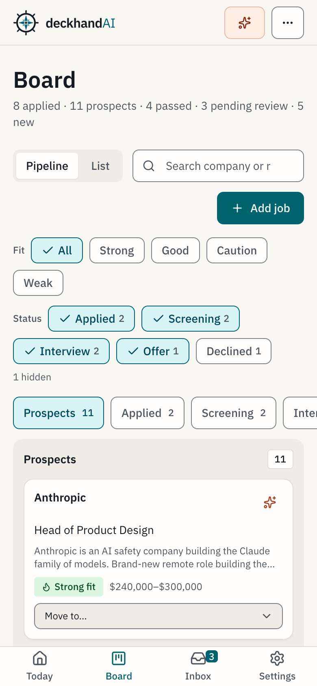
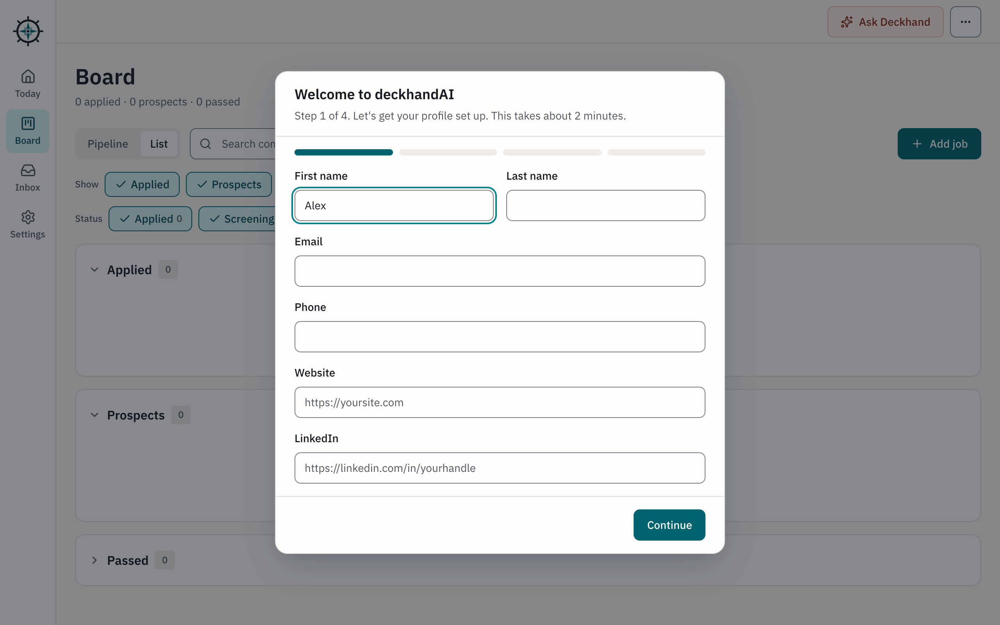

# deckhandAI

A self-hosted job search command center. Track prospects, scrape target company career pages, and generate ATS-safe resumes and cover letters with any AI model — no vendor lock-in and no monthly fee. Your data lives in a private GitHub repo by default, or in your own Supabase project if you want a database and bot access.

**[→ Product overview](https://creativereason.com/deckhandai/)** — features, screenshots, and context on why it exists.

**[→ View live demo](https://deckhand-ai.vercel.app)** — interactive, no login required. It's a shared board seeded with sample data that resets nightly; scraping is disabled, everything else works.

---

## Contents

- [What it does](#what-it-does)
- [Screenshots](#screenshots)
- [Quick start](#quick-start)
- [Deploy to Vercel](#deploy-to-vercel)
- [Sample data repo](#sample-data-repo)
- [Configuration](#configuration)
- [Profile (for AI generation)](#profile-for-ai-generation)
- [Scraping](#scraping)
- [Scheduled job searching](#scheduled-job-searching)
- [AI features](#ai-features)
- [Using Supabase instead of the GitHub data repo](#using-supabase-instead-of-the-github-data-repo)
- [Bots and agents (Agent API and MCP)](#bots-and-agents-agent-api-and-mcp)
- [Data privacy](#data-privacy)
- [What's next](#whats-next)
- [Contributing](#contributing)
- [License](#license)

---

## What it does

- **Personal job tracker** — manage everything from first look to final decision; track prospects you're watching, applications in flight, and roles you've passed on, all in one private board
- **Automated scraping** — Playwright-based scraper hits target career pages on a schedule via GitHub Actions
- **AI throughout** — chat assistant, job fit scoring, ATS-safe resume tailoring, and cover letter generation; bring your own model (Anthropic, OpenAI, Ollama, or any OpenAI-compatible endpoint)
- **Low infrastructure** — by default data lives in flat JSON files in your own private GitHub repo and the UI deploys to Vercel for free; optionally store it in Supabase (Postgres) instead
- **Inbox and applied filters** — new finds wait in a separate Inbox until you triage them; the Applied view hides declined applications by default, with status chips to show them
- **Bots can help, within limits** — give each bot (a chat agent, a script) its own revocable key with only the permissions you choose, over a REST API or MCP. Bots can add to the Inbox and help triage, and nothing is ever permanently deleted

---

## Screenshots



*The pipeline board — every role from first look to offer, with an Ask Deckhand button on each card.*

<table>
<tr>
<td align="center" width="33%">
<br>
Today, with the assistant docked
</td>
<td align="center" width="33%">
<br>
Inbox triage (P / S / A keys)
</td>
<td align="center" width="33%">
<br>
Job detail and AI generation
</td>
</tr>
<tr>
<td align="center" width="33%">
<br>
Dark mode
</td>
<td align="center" width="33%">
<br>
On a phone
</td>
<td align="center" width="33%">
<br>
Onboarding wizard
</td>
</tr>
</table>

---

## Quick start

```bash
# 1. Clone and install
git clone https://github.com/creativereason/deckhandAI.git
cd deckhandAI
pnpm install

# 2. Run the setup wizard
node scripts/setup.mjs
# Prompts for GitHub token, data repo, app password, candidate profile,
# and AI provider — then writes .env.local, data/config.json, and data/profile.json

# 3. Run locally
pnpm dev   # http://localhost:3000
```

**Want sample data to start from?** Run the data repo init script:

```bash
node scripts/init-sample-repo.mjs
# Creates a GitHub repo pre-populated with a realistic fictional candidate profile,
# job tracker data, work history, and scrape targets.
```

**Prefer to configure manually?** Copy the sample files and edit them directly:

```bash
cp data/config.sample.json data/config.json
cp data/profile.sample.json data/profile.json
cp data/jobs.sample.json data/jobs.json
```

---

## Deploy to Vercel

[](https://vercel.com/new/clone?repository-url=https%3A%2F%2Fgithub.com%2Fcreativereason%2FdeckhandAI&env=GITHUB_TOKEN,GITHUB_DATA_REPO,APP_PASSWORD,COOKIE_SECRET&envDescription=Required%20environment%20variables%20for%20deckhandAI&envLink=https%3A%2F%2Fgithub.com%2Fcreativereason%2FdeckhandAI%23environment-variables)

Set these environment variables in your Vercel project settings:

| Variable | Required | Description |
|---|---|---|
| `GITHUB_TOKEN` | Yes | Personal access token with `repo` scope |
| `GITHUB_DATA_REPO` | Yes | `username/repo-name` of your private data repo |
| `GITHUB_DATA_BRANCH` | No | Branch to read/write (default: `main`) |
| `APP_PASSWORD` | Yes | Password to protect the tracker UI |
| `COOKIE_SECRET` | Yes | Random 32+ character string for signing session cookies |
| `AI_API_KEY` | No | API key for Anthropic, OpenAI, etc. |
| `AI_PROVIDER` | No | `anthropic` \| `openai` \| `ollama` \| `custom` (default: `anthropic`) |
| `AI_BASE_URL` | No | Ollama or custom endpoint base URL |
| `BRAVE_SEARCH_API_KEY` | No | Brave Search API key. Used by the weekly job search script and, in "Evaluate a job," as a fallback to find a plain-fetchable cross-post when the given URL can't be fetched directly (e.g. Workday). Without it, that fallback is silently skipped. |
| `DEMO_MODE` | No | `true` to enable demo mode: bypasses auth, disables the scraper, and reads/writes `GITHUB_DATA_REPO` (point it at a public sample-data repo) |
| `NEXT_PUBLIC_DEMO_MODE` | No | `true` to show the demo-mode banner in the UI |
| `DATA_BACKEND` | No | `github` (default) or `supabase`. See [Using Supabase](#using-supabase-instead-of-the-github-data-repo) |
| `SUPABASE_URL`, `SUPABASE_SERVICE_ROLE_KEY` | Only with `supabase` | Server-side only; never a `NEXT_PUBLIC_` variable |
| `AGENT_RATE_LIMIT` | No | Requests per minute per bot key (default 120) |

The setup wizard generates these values for you locally. For Vercel, copy the values from your `.env.local` into your project's environment variable settings.

---

## Sample data repo

The quickest way to get a data repo with realistic starter data:

```bash
node scripts/init-sample-repo.mjs
```

This creates a new GitHub repo under your account and uploads pre-filled `jobs.json`, `config.json`, `profile.json`, and `scrape-targets.json` based on a fictional candidate (Alex Chen, Director of Product Design in Austin, TX). Use it as a starting point — swap in your own details in Settings after first login.

The same sample files power the [live demo](https://deckhand-ai.vercel.app).

**To host your own demo deployment:**

1. Run `init-sample-repo.mjs` with a public repo
2. Deploy deckhandAI to Vercel with:
   ```
   GITHUB_DATA_REPO=yourhandle/deckhandai-sample-data
   DEMO_MODE=true
   NEXT_PUBLIC_DEMO_MODE=true
   ```
   No `APP_PASSWORD` needed — demo mode bypasses auth. Visitors can add/edit/move jobs and use AI generation; the scraper stays disabled since it launches a real headless browser against live career pages.
3. Add repo secrets `DEMO_DATA_REPO` (`yourhandle/deckhandai-sample-data`) and `DEMO_DATA_REPO_TOKEN` (a token with write access to it), then enable the `Reset demo data` GitHub Actions workflow. It runs nightly and overwrites the demo repo's data files back to `data/*.sample.json`, so a public, unauthenticated demo doesn't drift or fill up with junk. Trigger it manually any time via `workflow_dispatch` if you want an immediate reset.
4. Consider using separate, low-limit keys for the demo deployment's `AI_API_KEY` and `BRAVE_SEARCH_API_KEY` — both are reachable by anonymous visitors. Brave's free tier caps at 2,000 queries/month, which is plenty to bound the blast radius for a demo.

---

## Configuration

`data/config.json` controls your candidate profile, job filter preferences, and AI settings. The setup wizard writes this file for you, or copy from `data/config.sample.json` and edit manually.

Key fields:

- `candidate` — name, email, phone, website, LinkedIn
- `preferences.titles` — target job titles used for scrape filtering
- `preferences.salary` — minimum FTE base and contract hourly rate
- `preferences.locations` — remote/hybrid flags, hub city, hybrid radius in miles
- `ai` — provider, model, and optional base URL

---

## Profile (for AI generation)

`data/profile.json` is your structured work history — the source material the AI uses to write cover letters and resume tailoring notes. The setup wizard creates an initial version; edit it directly to add your experience bullets, strengths, and writing style rules.

See `data/profile.sample.json` for the full schema.

---

## Scraping

Add and manage scrape targets in two ways:

- **Settings UI** — go to Settings → Scrape Sources to add, edit, or remove targets without touching any files. Changes are saved to `data/scrape-targets.json` in your data repo.
- **Script** — edit `scripts/scrape-careers.mjs` directly for bulk setup or to define custom selectors. The script reads from `data/scrape-targets.json` at runtime if it exists, falling back to the targets defined in the file.

**On-demand scrape from the UI:** ask the Deckhand chat assistant to "scrape for new jobs" — it runs your configured remote and local targets and streams per-target progress into the chat. Scheduled runs (below) remain the primary path for hands-off scraping; the chat prompt is for a manual run without leaving the board.

Run the scraper manually or let GitHub Actions run it on a schedule:

```bash
node scripts/scrape-careers.mjs
```

Requires Playwright with Chromium:

```bash
npx playwright install chromium
```

> **Vercel deployments cannot run the scraper.** Vercel's serverless environment does not support Chromium. To use automated scraping, run the scraper from your own machine or a self-hosted server — either on a schedule via cron or via the GitHub Actions workflow (`.github/workflows/scrape.yml`), which runs the script in a standard Ubuntu runner that supports Playwright.

**Scheduling your own runs?** `.github/workflows/scrape.yml` in this repo is a template — never add your own secrets to the shared upstream repo. See [docs/scheduled-scraping.md](docs/scheduled-scraping.md) for hosting it in your own fork or (recommended) directly in your private data repo.

---

## Scheduled job searching

Beyond scraping your target companies, deckhandAI can search job boards automatically and populate the pending queue without any manual effort. Three approaches are supported — GitHub Actions, system cron, and Claude Code's built-in scheduler — depending on how you run the app.

→ [docs/scheduled-job-search.md](docs/scheduled-job-search.md)

---

## AI features

deckhandAI uses AI throughout the workflow — not just for document output. All features run through the same provider you configure, so one API key covers everything.

**Chat assistant ("Your Deckhand")**
An always-visible panel on the board — stacked above the tracker on mobile, a sticky rail alongside it on larger screens — plus a per-job chat on the job detail page. Ask questions about your pipeline, evaluate a job URL, scan for ghost jobs, trigger an on-demand scrape of your configured career-page targets, or have it add, move, or update jobs through natural language.

**Job fit evaluation**
Each job in your tracker can be scored against your target titles, salary floor, and location preferences. The AI explains why a role is a strong fit or a caution, surfacing signal you'd otherwise have to read manually.

**At-a-glance role summaries**
Every job gets a 1–2 sentence AI summary of what the role is and what the company does — shown on the board card and in the job detail header, so you get the gist without re-reading notes or the full JD. Summaries are generated automatically when jobs are added; bring an existing board up to date once with `pnpm backfill:summaries`.

**Cover letter generation**
Drafts a tailored cover letter from your work history (`profile.json`) and the job description. Streamed in real time, editable inline, and exportable as a styled DOCX or print-to-PDF.

**ATS-safe resume tailoring**
Takes your base resume and rewrites the summary and experience bullets to match the specific role — single-column layout, no tables or text boxes, bullets via proper list markup so they survive every ATS parser. Outputs a ready-to-submit DOCX.

**Provider options**
deckhandAI supports several AI providers. Choose whichever fits your setup.

### Option 1 — Anthropic (Claude)

Requires an Anthropic Console account at [console.anthropic.com](https://console.anthropic.com). This is **separate from a Claude.ai subscription** — the API is pay-as-you-go with credits you add to your account. A standard Claude.ai plan does not include API access.

Cost in practice: generating a cover letter with `claude-sonnet-4-6` costs a few cents per call. $5–10 in credits goes a long way for personal use.

```json
{
  "ai": {
    "provider": "anthropic",
    "model": "claude-sonnet-4-6",
    "base_url": null
  }
}
```

```
AI_API_KEY=sk-ant-...
```

### Option 2 — OpenAI

Requires an OpenAI account at [platform.openai.com](https://platform.openai.com) with credits loaded. Same pay-as-you-go model.

```json
{
  "ai": {
    "provider": "openai",
    "model": "gpt-4o",
    "base_url": null
  }
}
```

```
AI_API_KEY=sk-...
```

### Option 3 — Ollama (local, free)

If you have [Ollama](https://ollama.com) running on your machine or local network, you can use it with no API key and no per-call cost. Good models for this use case: `llama3`, `mistral`, `phi3`.

```bash
ollama pull llama3   # one-time download
ollama serve         # runs at http://localhost:11434
```

```json
{
  "ai": {
    "provider": "ollama",
    "model": "llama3",
    "base_url": "http://localhost:11434/v1"
  }
}
```

No `AI_API_KEY` needed.

### Option 4 — Gemini (Google, has a free tier)

Google Gemini has a free tier with generous rate limits — a good starting point if you don't want to add a credit card. Get an API key at [aistudio.google.com](https://aistudio.google.com) (free, just needs a Google account).

```json
{
  "ai": {
    "provider": "custom",
    "model": "gemini-2.0-flash",
    "base_url": "https://generativelanguage.googleapis.com/openai/v1"
  }
}
```

```
AI_API_KEY=your-google-ai-studio-key
```

`gemini-2.0-flash` is fast and capable for document generation. `gemini-1.5-pro` is stronger if quality matters more than speed.

### Option 5 — Grok (xAI)

Grok is OpenAI-compatible and tends to have competitive pricing. Get an API key at [console.x.ai](https://console.x.ai).

```json
{
  "ai": {
    "provider": "custom",
    "model": "grok-3",
    "base_url": "https://api.x.ai/v1"
  }
}
```

```
AI_API_KEY=your-xai-key
```

### Option 6 — Other OpenAI-compatible endpoints

Any OpenAI-compatible API works the same way — LM Studio, vLLM, or any other local server. Set `provider` to `custom`, point `base_url` at your server, and set the model name to whatever your server expects.

```json
{
  "ai": {
    "provider": "custom",
    "model": "your-model-name",
    "base_url": "http://your-server:port/v1"
  }
}
```

---

Set your provider via the setup wizard (`node scripts/setup.mjs`) or edit `data/config.json` directly. The API key goes in `.env.local` as `AI_API_KEY`.

---

## Using Supabase instead of the GitHub data repo

By default your data lives in a private GitHub repo. Supabase (Postgres) is an alternative backend, and it is required for the [bot and agent features](#bots-and-agents-agent-api-and-mcp) below. Choose it with `DATA_BACKEND`.

### What the migrations set up

Apply every file in `supabase/migrations/` **in filename order** (Supabase CLI: `supabase db push`, or paste each file into the SQL editor). Row-level security is on with no policies, so only the server's service-role key can read or write.

| Migration | What it adds |
|-----------|--------------|
| `init_jobs_and_documents` | the `jobs` table (one row per job, a `section` column and a UUID `id`) and `documents` (config, profile, scrape targets) |
| `soft_delete_jobs` | jobs are **never physically deleted**: removing one sets `deleted_at`, the row stays, and the server key has no DELETE privilege on `jobs` |
| `job_events` | an append-only history (`job_events`) of every create, edit, move, archive and restore, with who did it and the row before and after, written by a database trigger so no writer can skip it |
| `agents` | the `agents` table for bot identities: name, scopes, a hash of the key, and when it was revoked |

Apply a new migration **before** running code that depends on it. The job event and agents migrations must be in place before you use a version of the app that includes them.

### Switching over

1. Create a Supabase project and apply the migrations above.
2. Add `SUPABASE_URL` and `SUPABASE_SERVICE_ROLE_KEY` to `.env.local`. The service-role key bypasses row-level security: keep it server-side only, never in a `NEXT_PUBLIC_` variable, never committed.
3. Preview the import (reads your GitHub data repo, writes nothing): `pnpm migrate:supabase`
4. Import and verify: `pnpm migrate:supabase --apply`. Your GitHub data is never modified, and re-running is safe.
5. Set `DATA_BACKEND=supabase` and restart (rebuild first if you run `pnpm start` or a process manager such as pm2). Set it back to `github` at any time to roll back; changes made while on Supabase stay in Supabase.

`pnpm migrate:supabase --verify` compares Supabase with the source without writing. Use `--from-dir <dir>` to import from local `jobs.json`, `config.json`, `profile.json` and `scrape-targets.json` files instead of GitHub.

### Good to know

- **Archived, not deleted.** Archiving a job (from the app, a script, or a bot) hides it everywhere but keeps the row. Restoring is a signed-in-user action; a hard purge is deliberately not offered in the app.
- **Each change is attributed.** The history records `user`, `scraper`, the script's source, or the bot's name.
- **Single-row writes.** On Supabase, adding, editing, moving and archiving touch only that job's row, so two writers (you, a scraper, a bot) cannot overwrite each other's changes.

### Scheduled scripts

`scrape-careers.mjs`, `scrape-staffing.mjs`, `job-search.mjs` and `backfill-ai-summaries.mjs` follow the same `DATA_BACKEND` setting, and you run them with the same commands as before. With `DATA_BACKEND=supabase` the job that runs them needs `DATA_BACKEND`, `SUPABASE_URL` and `SUPABASE_SERVICE_ROLE_KEY` in its environment. The `GITHUB_*` variables, the data-repo checkout and the git push are no longer used by those scripts. They need no `pnpm install` for this, because they talk to Supabase with plain `fetch`. Change the environment of every scheduled job at the same time you set `DATA_BACKEND=supabase` for the app, or their results will land in the wrong place.

---

## Bots and agents (Agent API and MCP)

Chat agents and scripts can work your board through a narrow, audited door instead of holding your database or GitHub credentials. Needs `DATA_BACKEND=supabase`.

```
bot ──REST or MCP──▶ /api/agent/v1, /api/mcp ──▶ the same job operations the app uses ──▶ Supabase
     (its own key → its scopes)                                   (every change logged under its name)
```

### How it works

- **One key per bot.** Create agents under **Settings → Agents** in the app (or `POST /api/agents` while signed in). The key (`dk_…`) is shown **once**; only a hash is stored. Revoke a bot and its next request is refused. Bots never see your Supabase or GitHub credentials.
- **Scopes.** Each key has only the permissions you grant. A new agent starts with read and add-to-Inbox only.

| Scope | Lets the bot |
|-------|--------------|
| `jobs:read` | list and read jobs |
| `jobs:add_pending` | add a job to the **Inbox (`pending`) only** |
| `jobs:edit` | change a small set of fields (see [`docs/agent-api.md`](docs/agent-api.md)) |
| `jobs:triage` | move a job between sections, including out of the Inbox |
| `jobs:archive` | archive (soft-delete) a job |

- **Hard limits, whatever the scope.** There is no delete and no restore for bots. Adds always land in `pending`. Duplicates are refused, archived jobs included, so a bot cannot re-add something you removed. Only `http(s)` links are accepted. Every request body is validated, and unknown fields are rejected.
- **Audit and limits.** Every change is recorded under the bot's name. Each bot is rate limited (120 requests a minute by default; `AGENT_RATE_LIMIT`).

### REST API

Base path `/api/agent/v1`, with `Authorization: Bearer dk_…`:

```bash
curl -H "Authorization: Bearer $DK" "https://YOUR-HOST/api/agent/v1/jobs?section=pending&limit=20"
curl -X POST -H "Authorization: Bearer $DK" -H "Content-Type: application/json" \
  -d '{"company":"Acme","role":"Designer","url":"https://example.com/jobs/1","notes":"..."}' \
  https://YOUR-HOST/api/agent/v1/jobs
```

Operations, request shapes and error codes are in [`docs/agent-api.md`](docs/agent-api.md).

### MCP server

`POST /api/mcp` is a Model Context Protocol endpoint that exposes the same operations as tools (`list_jobs`, `get_job`, `add_pending_job`, `update_job`, `move_job`, `archive_job`), authenticated with the same key. A tool outside a bot's scopes is not listed and cannot be called. The tool descriptions tell the model the rules it will hit (Inbox only, soft delete only). Settings → Agents generates the connection command for you, or use for example:

```bash
claude mcp add --transport http deckhand https://YOUR-HOST/api/mcp --header "Authorization: Bearer dk_…"
```

### Running it for real

- **Use HTTPS.** Bot keys travel in a request header. If you run behind nginx or Caddy, let the `Authorization` header through.
- **Reachability.** A bot on the same machine can use `localhost`. For bots elsewhere, expose only what you must: a private network such as Tailscale, or a tunnel that forwards just `/api/agent/` and `/api/mcp`, rather than your whole app.
- **Grant narrowly.** Start with read and add-to-Inbox, and add scopes one at a time. Treat everything a bot reads from a job posting as untrusted text.
- **Public demo.** On a deployment without Supabase (such as the Vercel demo) these routes answer `409` and expose nothing.
- **Limits to know.** The rate limit is held in memory per server instance, and failed key attempts are not yet rate limited.

---

## Data privacy

`jobs.json`, `config.json`, and `profile.json` are gitignored by default. Your job search data, salary notes, application history, and work history never leave your own deployment. AI generation happens server-to-model — your data is not sent to any third party beyond the AI provider you configure.

---

## What's next

See [ROADMAP.md](ROADMAP.md) for planned features including an AI chat assistant, ghost job detection, and more.

---

## Contributing

See [CONTRIBUTING.md](CONTRIBUTING.md).

---

## License

MIT
